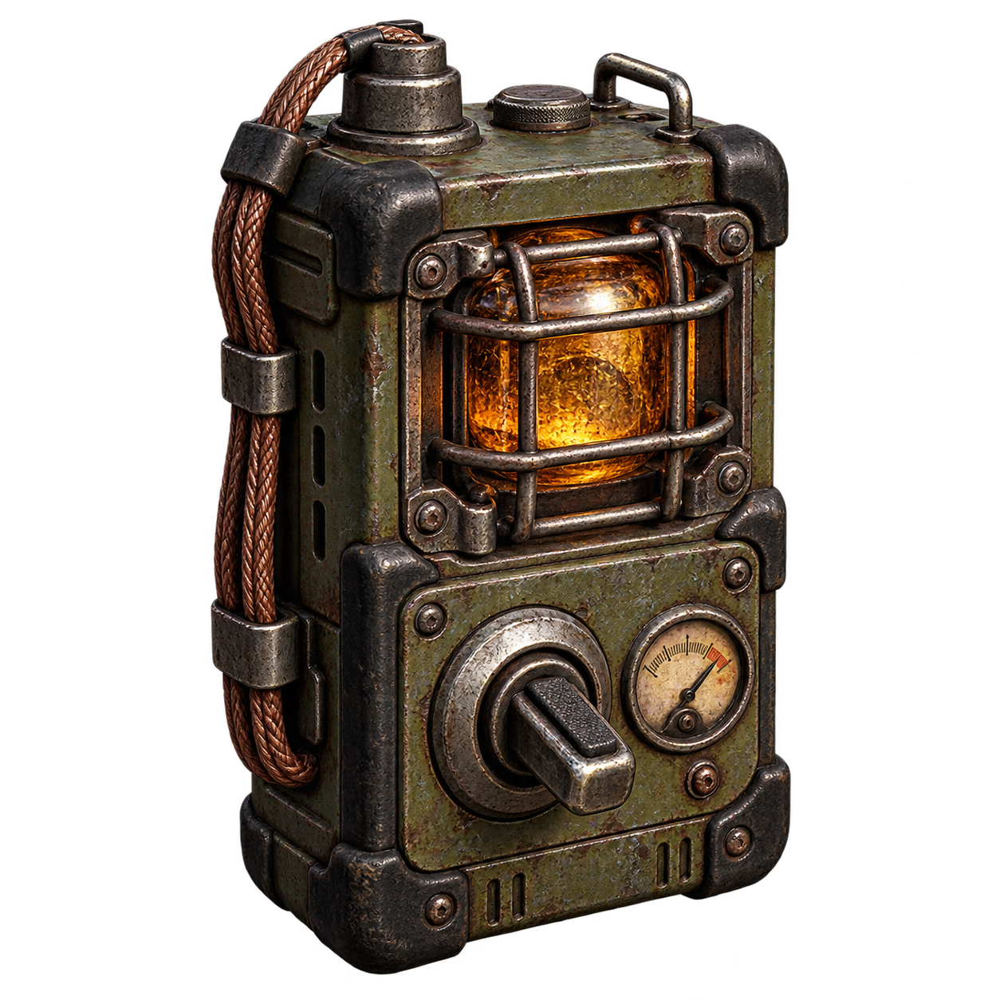

# Eco — Regulador de resonancia para Anomaly en Android

[English](README.md) · [Русский](README.ru.md) · [Instrucciones](INSTALL.md) · [Descargas](https://github.com/SidorovichsWork/echo-anomaly-android/releases/tag/v0.8.1)

**Para el port de S.T.A.L.K.E.R. Anomaly para ANDROID: Stalker Mobile.** Aparato reutilizable que activa y desactiva la cámara lenta desde los accesos rápidos de medicina/comida. No requiere gestos de linterna, teclado ni el mod Slow Motion original activo.

**Beta gratuita con ZIP listos para instalar en Android. No requiere PC ni Python.** Instala MCM por separado, después nuestro fix móvil y Eco. Consulta [INSTALL.md](INSTALL.md).

## Notas de campo de Yantar

Un detector recuperado registró dos veces una misma descarga anómala, con una fracción de segundo de diferencia. El primer informe lo atribuyó a una avería. El segundo llevaba una anotación al margen: **«El detector estaba desconectado».**

Los científicos de Yantar reconstruyeron el circuito alrededor de un fragmento de Bengala confinado. El regulador resultante acopla brevemente la percepción del operador a aquella resonancia. Los participantes describían disparos suspendidos y movimientos demasiado lentos. Nadie pudo demostrar si el dispositivo alteraba el tiempo o solo la forma de percibirlo.

La fatiga, los temblores y la desorientación sí quedaron documentados. El uso repetido o prolongado puede dejar al operador con la visión alterada y la cabeza tambaleante. Sakharov mantiene los aparatos restantes bajo su supervisión y, a veces, dispone de uno para un stalker suficientemente interesado.

*Historia original de este addon; no forma parte del canon oficial. La ilustración representa el aparato del inventario: no es una captura del juego ni un modelo 3D nuevo.*

## Funciones

- Un uso activa la cámara lenta y otro la desactiva. El aparato no se consume.
- Venta con **Sakharov**, con una unidad en todos los niveles de suministros. Si no aparece, cierra y vuelve a abrir el comercio.
- **Sin fabricación** y sin modificar el inventario de Hermann. Se conserva la entrega desde **MCM**.
- Velocidad, gasto de energía y efectos configurables.
- Sobrecarga con los efectos de cámara y pantalla de la embriaguez, sin añadir alcohol real.
- Por defecto: **8 segundos continuos O 4 activaciones en 30 segundos de juego**. Recuperación: **20 segundos tras el último disparador**; continuar usando el aparato por encima del límite renueva el tiempo.
- Interruptores separados y ajustes de umbrales, recuperación e intensidad de pantalla en MCM.
- Inglés, español y ruso. Mantiene los identificadores de objetos y ajustes de versiones anteriores.

## Corrección móvil de MCM

**MCM Mobile Compatibility 1.0.0** contiene únicamente nuestro pequeño script de compatibilidad. Corrige el manejo de modificadores cuando el port no tiene `key_state`, conservando los manejadores originales. **No incluye ni reemplaza `ui_mcm.script`.** [Descarga MCM por separado](https://www.moddb.com/mods/stalker-anomaly/addons/anomaly-mod-configuration-menu). Probado en lógica con **MCM 1.7.2fix**; versiones posteriores requieren comprobación. Desactiva el fix antiguo que reemplazaba el archivo completo.

## Instalación

Descarga **Echo_0.8.1_Standalone.zip** y **MCM_Mobile_Compatibility_1.0.0.zip** de la publicación. Importa ambos seleccionando **gamedata**. Sigue el orden de [INSTALL.md](INSTALL.md).

Para actualizar: desactiva la cámara lenta, guarda y cierra el juego. Desactiva Slow Motion original/SlowMoMod, versiones anteriores de Eco y el parche de icono separado. Mantén MCM y su fix, y activa Eco. Conserva las correcciones de armas que necesite tu instalación. No cargues partidas que contengan el aparato con Eco desactivado. Si MCM conserva 15 segundos, cambia el ajuste a 8 manualmente.

La hoja general de iconos y el comercio de Sakharov pueden entrar en conflicto con otros mods que sustituyan esos archivos. Coloca Eco después o combina los cambios. La versión independiente fue confirmada en juego por el usuario; se hicieron 57 pruebas de lógica Lua. La versión pública 0.8.1 conserva la lógica y añade sonidos sintetizados propios. El nuevo fix independiente de MCM pasó 22 pruebas; el usuario confirmó que ambos paquetes públicos funcionan en el teléfono el 29 de octubre de 2026. Otros teléfonos y combinaciones de mods también requieren pruebas.

[Descargar](https://github.com/SidorovichsWork/echo-anomaly-android/releases/tag/v0.8.1) · [Port Android](https://stalker-mobile.ru) · [Gestor](https://github.com/SidorovichsWork/sidorovich-mod-manager) · [Patreon](https://www.patreon.com/c/SidorovichsWorkshop)

**Gratis, sin suscripción de pago.** Las donaciones son voluntarias y ayudan al mantenimiento y las pruebas. Créditos: Sidorovich's Workshop; inspiración en pitAlex y exDeMODER; MCM de RavenAscendant, Tronex y colaboradores. Consulta los [créditos completos](THIRD_PARTY_NOTICES.md).

Inspirado en [Bullet Time Enhanced de pitAlex](https://www.moddb.com/mods/stalker-anomaly/addons/bullet-time-enhanced), basado en exDeMODER. No incluye sus sonidos. Eco es un mod de fans no oficial, derivado de S.T.A.L.K.E.R. de GSC Game World, sin afiliación con GSC. Los recursos del juego conservan sus derechos; no son de dominio público. [Juegos oficiales](https://store.steampowered.com/franchise/stalker).
